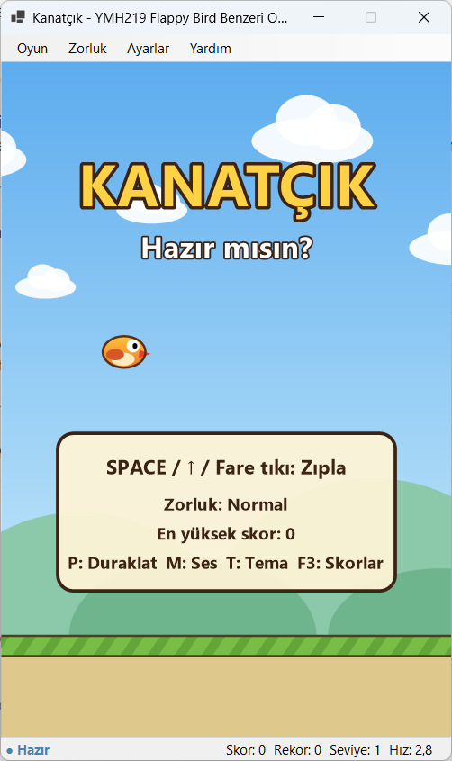
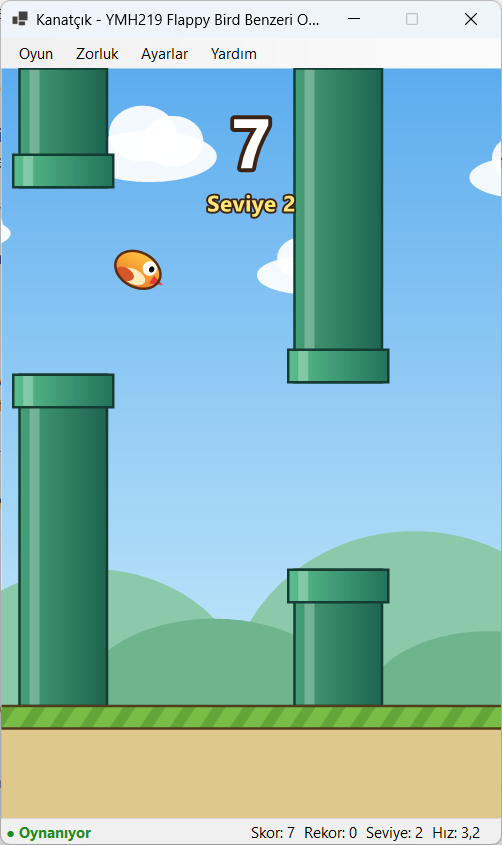
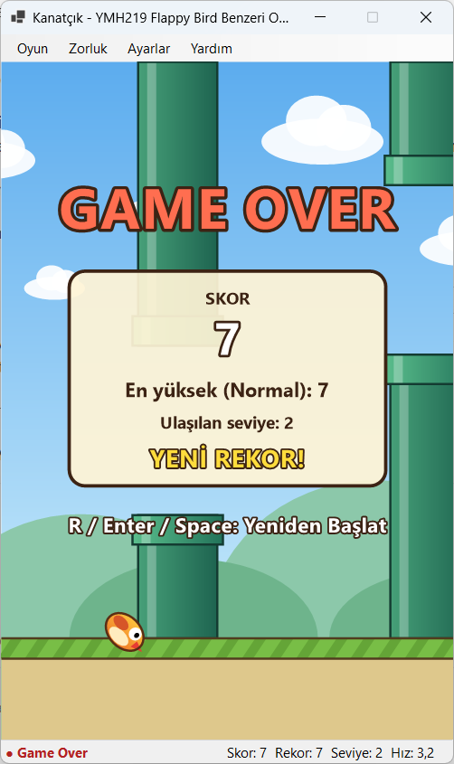
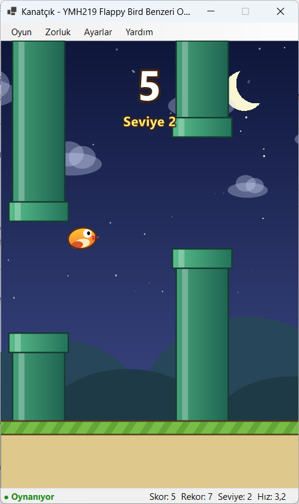
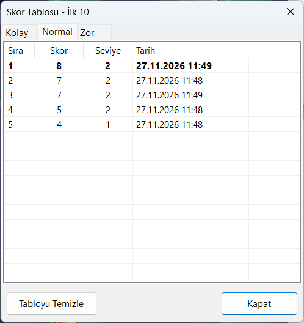

# YMH219-FlappyBird — Kanatçık

**Kanatçık**, Windows Forms ile geliştirilmiş Flappy Bird benzeri bir masaüstü oyunudur. Oyuncu klavyeyle kuşu zıplatır, kuş yer çekimiyle aşağı düşer. Amaç, sağdan sola gelen engellerin arasındaki boşluktan geçerek mümkün olduğunca yüksek skor yapmaktır.

> YMH 219 Nesne Tabanlı Programlama — Ek Uygulama Ödevi 3

## Ekran Görüntüleri

| Başlangıç | Oyun | Game Over |
|:---:|:---:|:---:|
|  |  |  |

| Gece teması | Skor tablosu (ilk 10) |
|:---:|:---:|
|  |  |

## Kullanılan Teknolojiler

- C# (.NET 10)
- Windows Forms (`Form`, `Panel`, `MenuStrip`, `StatusStrip`, `Timer`, `TabControl`, `ListView`)
- GDI+ (`System.Drawing`) ile çizim
- `System.Media.SoundPlayer` ile ses efektleri
- Harici NuGet paketi **kullanılmamıştır**

## Kurulum ve Çalıştırma

**Gereksinimler:** Windows 10/11 ve .NET 10 SDK (veya .NET masaüstü geliştirme iş yükü kurulu Visual Studio 2026)

**Visual Studio ile:**
1. Depoyu klonlayın: `git clone https://github.com/ayhayat932-svg/YMH219-FlappyBird.git`
2. `FlappyBird.slnx` dosyasını Visual Studio ile açın.
3. `F5` ile derleyip çalıştırın.

**Komut satırı ile:**
```powershell
dotnet run --project FlappyBird/FlappyBird.csproj
```

## Kontroller

| Tuş | İşlev |
|---|---|
| `Space` / `↑` / `W` / Sol tık | Zıpla (oyunu başlatır) |
| `P` / `Esc` | Duraklat / Devam |
| `R` / `F2` | Yeni oyun |
| `Enter` | Game Over ekranında yeniden başlat |
| `M` | Sesi aç / kapat |
| `T` | Gündüz / gece teması |
| `F3` | Skor tablosu (ilk 10) |
| `F1` | Kontroller penceresi |

## Temel Özellikler

**Asgari gereksinimler**
- Kuş klavyeyle yukarı zıplar ve yer çekimiyle aşağı iner (`Bird.Flap`, `Bird.ApplyPhysics`).
- Ekranda aynı anda **3 engel** sağdan sola hareket eder. Ekrandan çıkan engel, en sağdaki engelin arkasına yeni bir boşluk yüksekliğiyle taşınır (`GameEngine.RecyclePipe`).
- Engele veya zemine çarpınca oyun durur ve **Game Over** ekranı gösterilir.
- Geçilen her engel için skor 1 artar.
- Menüden (`Oyun → Yeni Oyun`), `F2`, `R` veya `Enter` ile oyun yeniden başlatılabilir.
- Hız, skor, seviye ve oyun durumu `GameEngine` sınıfının özelliklerinde tutulur ve durum çubuğunda gösterilir.

**İsteğe bağlı geliştirmeler**
- **En yüksek skor dosyada saklanır:** Her zorluk seviyesi için **ilk 10 skor**; skor, ulaşılan seviye ve tarih bilgisiyle `%AppData%\YMH219-FlappyBird\highscores.txt` dosyasında tutulur. `Oyun → Skor Tablosu` (F3) penceresinde her zorluk ayrı bir sekmede listelenir ve tablo, onay alındıktan sonra temizlenebilir. Game Over ekranında oyunun tablodaki sırası gösterilir.
- **Seviye ilerledikçe hız artar:** Her 5 puanda seviye atlanır ve engeller hızlanır.
- **Ses efektleri:** Zıplama, puan, seviye atlama ve çarpma sesleri, harici dosya gerekmeden kod içinde üretilir.
- **Zorluk seviyeleri:** Kolay, Normal ve Zor seviyelerinde başlangıç hızı ve boşluk yüksekliği farklıdır.
- **Gece teması:** `Ayarlar → Gece Teması` veya `T` tuşuyla, parıldayan yıldızlar ve hilal içeren gece arka planına geçilir.
- Pencere odağı kaybedildiğinde oyun otomatik olarak duraklar.

## Proje Yapısı ve Sınıf Tasarımı

```
FlappyBird/
├── Program.cs                  Giriş noktası, genel hata yakalama
├── MainForm.cs / .Designer.cs  Pencere: Timer, KeyDown/KeyUp, menü, durum çubuğu
├── ScoreBoardForm.cs / .Designer.cs  İlk 10 skor tablosu penceresi
├── Game/
│   ├── GameObject.cs           Konumu ve boyutu olan nesneler için soyut temel sınıf
│   ├── Bird.cs                 Oyuncu (GameObject'ten türer): yer çekimi, zıplama, çizim
│   ├── PipePair.cs             Üst/alt engel çifti (GameObject'ten türer): hareket, çarpışma
│   ├── GameEngine.cs           Oyun mantığı: durum, skor, seviye, hız, olaylar (event)
│   ├── GameState.cs            Ready / Playing / Paused / GameOver
│   └── DifficultySettings.cs   Zorluk seviyesi ayarları
├── Rendering/
│   ├── GameRenderer.cs         Arka plan, zemin, skor ve bilgi ekranlarının çizimi
│   └── ThemePalette.cs         Gündüz / gece renk temaları
├── Services/
│   ├── HighScoreRepository.cs  İlk 10 skorun dosyaya okunması/yazılması
│   ├── ScoreEntry.cs           Skor kaydı (skor, seviye, tarih)
│   └── SoundEffects.cs         Ses efektleri
└── Controls/
    └── GamePanel.cs            Titreşimsiz çizim için çift tamponlu panel
```

- **Kalıtım:** `Bird` ve `PipePair`, ortak `GameObject` soyut sınıfından türer ve `Draw` metodunu kendine göre uygular (override).
- **Sorumlulukların ayrılması:** Oyun kuralları `GameEngine` sınıfında, çizim `GameRenderer` sınıfında, dosya işlemleri `HighScoreRepository` sınıfında, kullanıcı etkileşimi ise `MainForm` sınıfındadır.
- **Olaylar (event):** `GameEngine`; `StateChanged`, `ScoreChanged`, `LevelChanged`, `Flapped` ve `Crashed` olaylarını yayınlar. Form bu olaylara abone olarak durum çubuğunu günceller ve sesleri çalar.
- **Oyun döngüsü:** `Timer` (15 ms) her tikte `engine.Update()` çağırır ve paneli yeniden çizdirir.
- **Çarpışma kontrolü:** Kuşun biraz küçültülmüş `HitBox` dikdörtgeninin, engelin `TopRect` / `BottomRect` dikdörtgenleriyle kesişip kesişmediğine bakılır (`RectangleF.IntersectsWith`).
- **Hata kontrolleri:** Skor dosyası okunamazsa veya yazılamazsa kullanıcı uyarılır ve oyun devam eder. Bozuk satırlar atlanır. Ses aygıtı yoksa sesler sessizce kapatılır. Geçersiz parametreler `ArgumentException` fırlatır.

## Bilinen Sınırlamalar / Geliştirme Notları

- Oyun döngüsü `System.Windows.Forms.Timer` ile kare tabanlıdır. Bu yüzden çok yavaş bilgisayarlarda oyun biraz yavaşlayabilir.
- `SoundPlayer` aynı anda tek ses çalabildiği için art arda gelen sesler birbirini kesebilir.
- Uygulama yalnızca Windows'ta çalışır (Windows Forms).
- Seçilen tema bir sonraki açılışta hatırlanmaz; oyun her zaman gündüz temasıyla başlar.
- Gelecekte eklenebilecekler: tema ve ses tercihinin kaydedilmesi, oyun kumandası desteği, farklı kuş görünümleri.

## Öğrenci Bilgileri

- **Ad Soyad:** Hayat Ay
- **Öğrenci No:** 250541055
